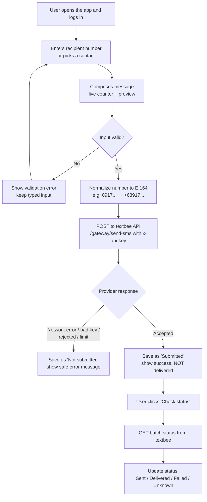

# Django SMS Sender

**IT 120 – Integrative Programming and Technologies · Group Laboratory/Assignment**

A Django web application for sending SMS messages through an external SMS gateway API. The user enters a recipient phone number and a message. The app validates the input, submits the message to the SMS provider, shows clear success or error feedback, and tracks the message status until the carrier confirms delivery.

---

## 1. Application objectives

| | |
|---|---|
| **Purpose** | Send SMS text messages from a web browser through an SMS provider's API, with proper validation, error handling and secure credential management. |
| **Users** | Authorized users, such as a teacher, small office or organizer, who need to send short notifications or reminders to mobile numbers. Users must log in first. |
| **SMS functionality** | Compose and send an SMS, see whether the provider **accepted** it, check whether it was **delivered**, browse past attempts and save contacts. |

## 2. Group members and responsibilities

This project was completed by **one member**. As the assignment allows for smaller groups, all roles were handled by the same person.

| Member | Responsibilities |
|---|---|
| **Glein Ardian** | Django project setup, models, views and URLs (Member 1 role) · User interface, forms, validation and user feedback (Member 2 role) · SMS provider integration, testing, documentation and demonstration (Member 3 role) |

## 3. Main features

### Core features
- **SMS composition form** with a recipient phone number field, a message field and a **Send SMS** button, protected by Django's CSRF token.
- **SMS sending** through the textbee.dev SMS gateway REST API.
- **Input validation**, both server-side in Django forms and client-side in JavaScript, for:
  - an empty phone number or empty message (including whitespace-only messages)
  - invalid characters and invalid number length
  - Philippine local numbers like `09171234567`, which are **converted automatically** to international E.164 format (`+639171234567`)
  - messages over the maximum length (480 characters)
- **Error handling** with friendly messages for missing credentials, wrong API key, network and timeout errors, provider rejections, rate limits and provider outages. **API keys are never shown in error messages.**
- **Honest status reporting:** a successful API call is shown as **"Submitted"**, never as "Delivered". The status becomes **Delivered** only when the carrier confirms it.

### Additional features
| Feature | Description |
|---|---|
| **Message history** | Every attempt, including failed ones, is saved and listed with search, status filter and pagination. |
| **Message status tracking** | A **Check status** button, plus **Check pending statuses** for all messages, asks the provider for the latest status. A timeline shows *Submitted → Sent → Delivered*. |
| **Contact management** | Add, edit, delete and search contacts. Pick a contact on the send page, or click **Send** next to a contact. |
| **Character counter** | Live count of characters, SMS segments and encoding (GSM-7 or Unicode), with a progress bar. |
| **Message preview** | A phone-style preview of the message and recipient, updated as you type. |
| **Dashboard** | Totals, acceptance rate, delivery rate, messages by status and recent attempts. |
| **Test mode** | `SMS_PROVIDER=console` simulates sending, so the app can be developed and tested without using SMS credits. |
| **Login required** | Only logged-in users can send SMS, which prevents strangers from using your SMS credits. |

## 4. Technologies and dependencies

| Technology | Use |
|---|---|
| Python 3.12 | Programming language |
| Django 6.1 | Web framework (views, forms, ORM, auth, CSRF, messages) |
| SQLite | Database for messages and contacts |
| requests | HTTP client for calling the SMS provider's REST API |
| python-dotenv | Loads secret settings from a local `.env` file |
| Bootstrap 5.3 + Bootstrap Icons | Responsive user interface (loaded from a CDN) |
| JavaScript (vanilla) | Character counter, live preview, client-side validation |
| **textbee.dev** | SMS gateway provider (REST API + Android app) |

Exact versions are in [`requirements.txt`](requirements.txt).

### Why textbee.dev instead of Twilio?
The assignment asks for "an SMS service provider **such as** Twilio". I tried the following providers:

1. **Twilio:** free trials are **not available in the Philippines**. Only a paid account was offered.
2. **Infobip:** the free trial works, but **sending SMS to the Philippines is restricted** until a manual approval is granted.
3. **textbee.dev:** free (300 SMS/month), no country restrictions. It turns a registered **Android phone into an SMS gateway** that is controlled through a REST API with an API key, and it reports delivery status. ✅ Chosen.

The provider code is isolated in [`sms_app/providers.py`](sms_app/providers.py). Another provider, such as Twilio, can be added by writing one more class with `send()` and `get_status()` methods.

## 5. Project structure

```
IT120/
├── manage.py
├── requirements.txt
├── .env.example            # safe template of the required settings (no secrets)
├── .gitignore              # excludes .env, venv, db.sqlite3, caches
├── sms_project/            # Django project
│   ├── settings.py         # reads secrets from environment variables / .env
│   └── urls.py
├── sms_app/                # Django application
│   ├── models.py           # Contact and Message (status tracking)
│   ├── forms.py            # SMSForm and ContactForm with validation
│   ├── validators.py       # phone number validation and normalization
│   ├── providers.py        # SMS provider integrations (textbee, console test mode)
│   ├── services.py         # send_sms() and refresh_status() application logic
│   ├── views.py            # compose, dashboard, history, status, contacts
│   ├── urls.py
│   ├── admin.py
│   ├── tests.py            # 43 automated tests
│   └── templates/sms_app/  # page templates
├── templates/              # base layout and login pages
└── static/                 # css/app.css, js/compose.js
```

## 6. SMS workflow



| Step | What happens | Code |
|---|---|---|
| 1. Open app | User logs in and opens the **Send SMS** page | `views.compose` (GET) |
| 2. Recipient | Types a number or picks a saved contact | `SMSForm.recipient`, `SMSForm.contact` |
| 3. Message | Types the message; counter and preview update live | `static/js/compose.js` |
| 4. Validate | Required fields, phone format and length are checked | `forms.py`, `validators.py` |
| 5. Send | Request is sent to the SMS provider's API | `services.send_sms` → `providers.TextBeeProvider.send` |
| 6. Result | Success or error message is shown and the attempt is saved | `views.compose`, `Message` model |
| 7. Track | Status is checked until Delivered or Failed | `services.refresh_status` → `TextBeeProvider.get_status` |

**Message statuses**

| Status | Meaning |
|---|---|
| Not submitted | The provider never accepted the request (validation, credentials, network or provider error). |
| Submitted | The provider accepted and queued the message. **Delivery is not confirmed.** |
| Sent | The phone and carrier report that the SMS left the sending device. |
| Delivered | The carrier confirmed delivery to the recipient. |
| Failed | The provider or carrier reported a final failure. |
| Unknown | No delivery report was received yet. The status may still change. |

## 7. Installation and setup

**Requirements:** Python 3.10+ and Git. To send real SMS you also need an Android phone with a SIM that has load.

```bash
# 1. Clone the repository
git clone https://github.com/naidradota2/it120.git
cd it120

# 2. Create and activate a virtual environment
python3 -m venv venv
source venv/bin/activate          # Windows: venv\Scripts\activate

# 3. Install dependencies
pip install -r requirements.txt

# 4. Create your local configuration file
cp .env.example .env              # Windows: copy .env.example .env
#    then edit .env and set DJANGO_SECRET_KEY (see the comment in the file)

# 5. Create the database tables
python manage.py migrate

# 6. Create a login account
python manage.py createsuperuser
```

## 8. Configuring the SMS provider (textbee.dev)

1. Create a free account at **https://textbee.dev**.
2. Install the **textbee Android app** on your phone using the link in the dashboard.
3. In the dashboard, generate an **API key**. In the app, scan the QR code (or enter the key) to register the phone. Leave the app's optional *Device ID* field empty the first time.
4. Allow the app to **send SMS** on the phone.
5. Copy the **Device ID** of your phone from the dashboard.
6. Open your local `.env` file and set:
   ```ini
   SMS_PROVIDER=textbee
   TEXTBEE_API_KEY=<your API key>
   TEXTBEE_DEVICE_ID=<your device id>
   ```
7. Restart the Django server.

> 🔒 **Security:** credentials live only in `.env`, which is listed in `.gitignore` and is never committed. `.env.example` contains placeholders only. Never show the `.env` file or the textbee dashboard's API key in screenshots or videos.

To develop **without sending real SMS**, keep `SMS_PROVIDER=console` (test mode). Messages are logged in the terminal and saved in the history with a "test" label.

## 9. Running the application

```bash
source venv/bin/activate
python manage.py runserver
```

Open **http://127.0.0.1:8000/** and log in with the account you created.

| Page | URL |
|---|---|
| Send SMS | `/` |
| Dashboard | `/dashboard/` |
| Message history | `/history/` |
| Contacts | `/contacts/` |
| Django admin | `/admin/` |

## 10. Testing procedures and results

### 10.1 Automated tests
The automated tests **mock the SMS provider's HTTP requests**, so they are free, need no internet and never send real SMS.

```bash
python manage.py test
```

**Result:** `Ran 43 tests ... OK` ✅

| Area | What is tested |
|---|---|
| Phone validation (10 tests) | International, spaced/dashed and local `09...` formats; empty, letters, too short, wrong Philippine length, missing country code |
| Form validation (6 tests) | Valid form, empty phone, empty message, whitespace-only message, too-long message, contact fills recipient |
| Provider integration (12 tests) | Correct URL, headers and body; missing credentials; wrong API key (401, key not leaked); connection error; timeout; provider rejection (400); rate limit (429); `success: false`; delivered / failed / batch status mapping; unknown provider |
| Views (15 tests) | Login required, form fields and CSRF token, valid send shows "Submitted" (not delivered), each validation error, credential / network errors shown safely, input kept after error, status refresh, open-redirect protection, history / dashboard / contacts pages |

### 10.2 Assignment test cases

| # | Test case | Expected result | Automated test | Automated result | Manual check (live app) |
|---|---|---|---|---|---|
| 1 | Valid phone number and message | App sends the SMS and shows the provider's response | `test_valid_send_shows_submitted_not_delivered`, `test_successful_send_returns_batch_id` | ✅ Pass | ☐ Sent to an authorized number via textbee: _received? delivery time?_ |
| 2 | Empty phone number | Submission rejected with a validation message | `test_empty_phone_rejected` | ✅ "Please enter the recipient phone number." | ☐ |
| 3 | Empty message | Submission rejected with a validation message | `test_empty_message_rejected` | ✅ "Please enter a message." | ☐ |
| 4 | Invalid phone number (e.g. `12345`, `0917ABC4567`) | Validation error shown, nothing sent | `test_invalid_phone_rejected` + 5 validator tests | ✅ Format error shown, no message saved | ☐ |
| 5 | Incorrect or missing credentials | Error handled without exposing secrets | `test_missing_credentials_shows_safe_error`, `test_wrong_credentials_do_not_leak_key` | ✅ Safe messages; API key never displayed | ☐ Blank / wrong `TEXTBEE_API_KEY` in `.env` |
| 6 | Provider or network error | Understandable failure message | `test_network_error_message`, `test_timeout`, `test_provider_rejects_message`, `test_rate_limited` | ✅ "Could not reach the SMS provider..." etc. | ☐ Wi-Fi turned off while sending |
| 7 | Successful provider response | Confirms **submission** without claiming delivery | `test_valid_send_shows_submitted_not_delivered`, `test_status_delivered` | ✅ Shows **Submitted**; **Delivered** only after the status check confirms it | ☐ |

> Tick the manual checks (☐ → ✅) and fill in the live results after testing the running app with real textbee credentials.

## 11. Security measures
- API credentials are stored in **environment variables** loaded from `.env`, which is git-ignored. Only `.env.example` with placeholders is committed.
- The Django `SECRET_KEY` is read from the environment. The app refuses to start with `DEBUG=False` and no key set.
- **CSRF protection** on every form, including logout and the status-check buttons.
- **Login required** for every page, so strangers cannot spend your SMS credits.
- Error messages shown to users never include API keys or raw provider responses.
- Protection against **double submission** (the Send button is disabled while sending).
- Redirects after a status check only go to pages on this site (open-redirect protection).
- Messages are rendered with Django auto-escaping and `textContent` in JavaScript (XSS protection).
- Testing used only **authorized recipients** (my own numbers).

## 12. Known limitations
- **textbee depends on the Android phone:** it must be on, connected to the internet, running the textbee app and have SMS load. If the phone is offline, messages stay **Submitted** until it reconnects.
- Messages are sent from the phone's **own number**, not a branded sender name.
- The free textbee plan allows about **300 SMS per month and 50 per day**.
- Delivery status is updated when the user clicks **Check status**. Webhooks for automatic updates are not implemented, because the app runs on a local computer that textbee cannot reach.
- Sends to **one recipient at a time**. There is no bulk sending.
- Uses SQLite and Django's development server, which is suitable for a class project but not for production.
